<picture>
  <source media="(prefers-color-scheme: dark)" srcset="assets/header-dark.svg" />
  <source media="(prefers-color-scheme: light)" srcset="assets/header-light.svg" />
  
</picture>

i learn by building. this is where my experiments, side quests and finished things end up.

<a href="https://dipannshuuuu.web.app">portfolio</a> · <a href="https://www.linkedin.com/in/dipanshu-singh-86b2ba444/">linkedin</a> · <a href="mailto:diipanshuuuu@gmail.com">email</a> · <a href="https://dipannshuuuu.web.app/resume.pdf">résumé</a> · <a href="https://discord.com/users/1287480096806011007">discord</a>

<br />

### `$ cat about.py`

```python
class Dipanshu:
    """first-year cs student who learns by building things."""

    home     = "Ayodhya, India"
    studying = "B.Tech CSE (AI & ML) @ Newton School of Technology"
    shipped  = ["Kavach", "NST SDC site", "SysCleanX", "portfolio"]
    open_to  = ["internships", "freelance", "open-source collabs"]

    def now(self):
        return "still exploring."
```

### `$ ls ~/tools`

<picture>
  <source media="(prefers-color-scheme: dark)" srcset="https://skillicons.dev/icons?i=py%2Cjs%2Cc%2Ccpp%2Crust%2Cbash%2Chtml%2Ccss%2Cgit%2Cgithub%2Clinux%2Cvim%2Cvscode%2Cfirebase%2Cvercel&perline=15&theme=dark" />
  <source media="(prefers-color-scheme: light)" srcset="https://skillicons.dev/icons?i=py%2Cjs%2Cc%2Ccpp%2Crust%2Cbash%2Chtml%2Ccss%2Cgit%2Cgithub%2Clinux%2Cvim%2Cvscode%2Cfirebase%2Cvercel&perline=15&theme=light" />
  
</picture>

### `$ ls ~/projects`

<table>
  <tr>
    <td colspan="2" valign="top">
      <p><a href="https://github.com/diipanshuuuu/Kavach"><b>Kavach</b></a> <sub>· built at hacktoberfest hack day pune 2026</sub></p>
      <p>A browser extension that spots Indian personal data (Aadhaar, PAN, bank details, names, addresses) in anything you paste or upload, and masks it before it reaches ChatGPT, Gemini or Claude. Nothing leaves your laptop, and it also works on images, scanned PDFs and slides in English, Hindi and Marathi.</p>
      <p><sub><b>97.3% recall</b> · <b>100% precision</b> · ~60 ms per document</sub></p>
      <sub><code>python</code> <code>fastapi</code> <code>transformers</code> <code>tesseract</code> <code>typescript</code></sub>
    </td>
  </tr>
  <tr>
    <td width="50%" valign="top">
      <p><a href="https://github.com/diipanshuuuu/NST-SDC-site"><b>NST SDC site</b></a> <sub>· <a href="https://nst-sdc-site-ten.vercel.app">live ↗</a></sub></p>
      <p>An unofficial redesign of my college dev club's site, built from scratch, with an in-browser terminal, a <kbd>⌘K</kbd> palette and a showcase of real student repos. No frameworks.</p>
      <sub><code>html</code> <code>css</code> <code>javascript</code></sub>
    </td>
    <td width="50%" valign="top">
      <p><a href="https://github.com/htmnsrc/SysCleanX"><b>SysCleanX</b></a> <sub>· where it started</sub></p>
      <p>A minimal Windows cleaner and uninstaller. It clears temp files, caches and the recycle bin from one lightweight window.</p>
      <sub><code>python</code> <code>customtkinter</code></sub>
    </td>
  </tr>
</table>

### `$ now`

<a href="https://discord.com/users/1287480096806011007">
  <picture>
    <source media="(prefers-color-scheme: dark)" srcset="https://lanyard.cnrad.dev/api/1287480096806011007?theme=dark&bg=0d1117&borderRadius=8px&hideDiscrim=true&hideBadges=true&idleMessage=quiet%20for%20now%20%C2%B7%20probably%20building%20something" />
    <source media="(prefers-color-scheme: light)" srcset="https://lanyard.cnrad.dev/api/1287480096806011007?theme=light&bg=ffffff&borderRadius=8px&hideDiscrim=true&hideBadges=true&idleMessage=quiet%20for%20now%20%C2%B7%20probably%20building%20something" />
    
  </picture>
</a>

<br />
<br />

<sub>psst, press <kbd>/</kbd> on <a href="https://dipannshuuuu.web.app">my portfolio</a> and try <code>sudo hire-me</code></sub>
